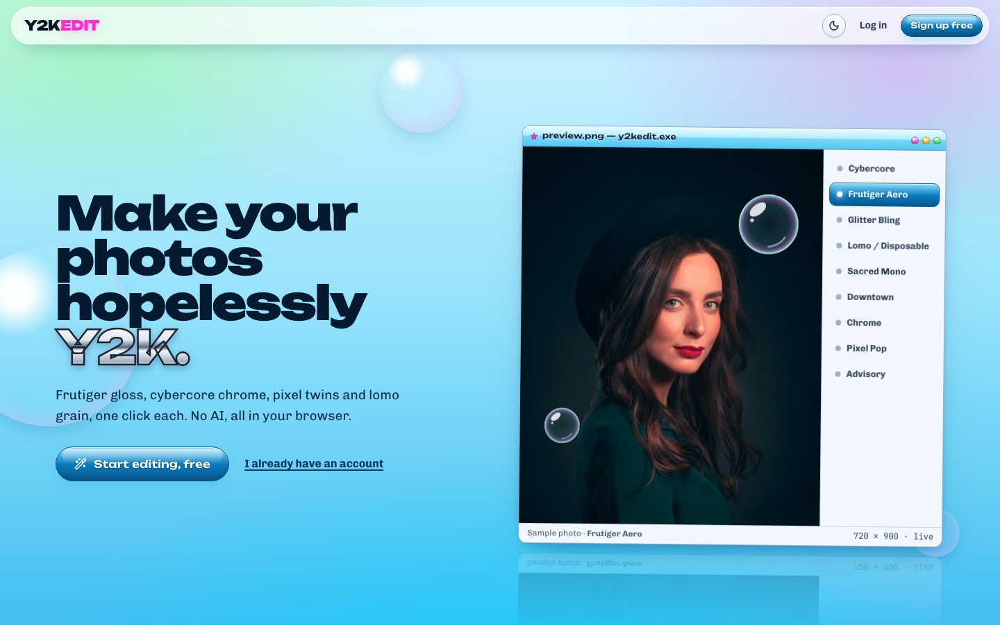
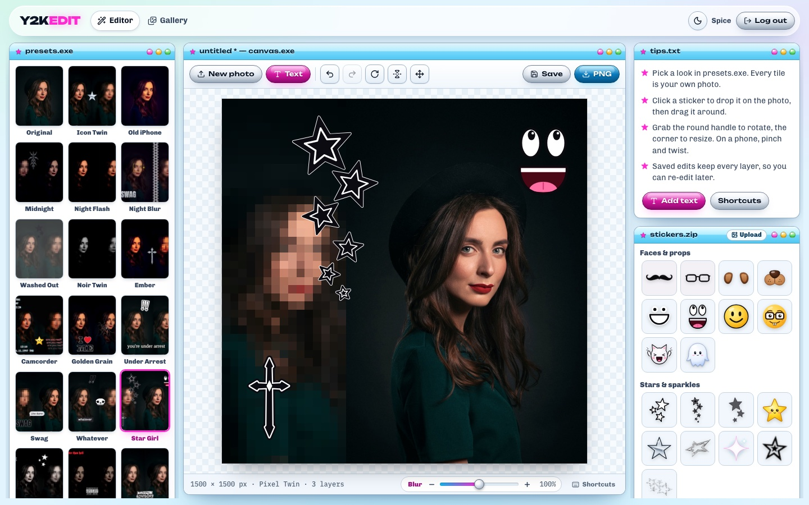
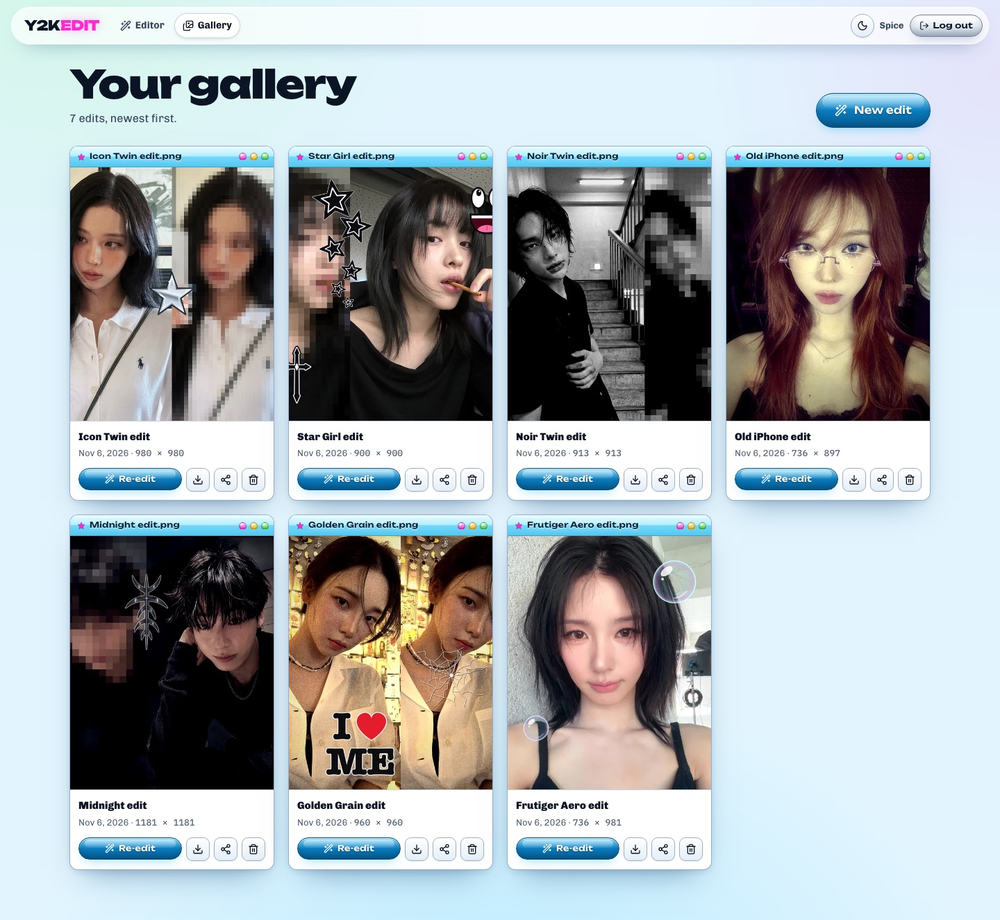
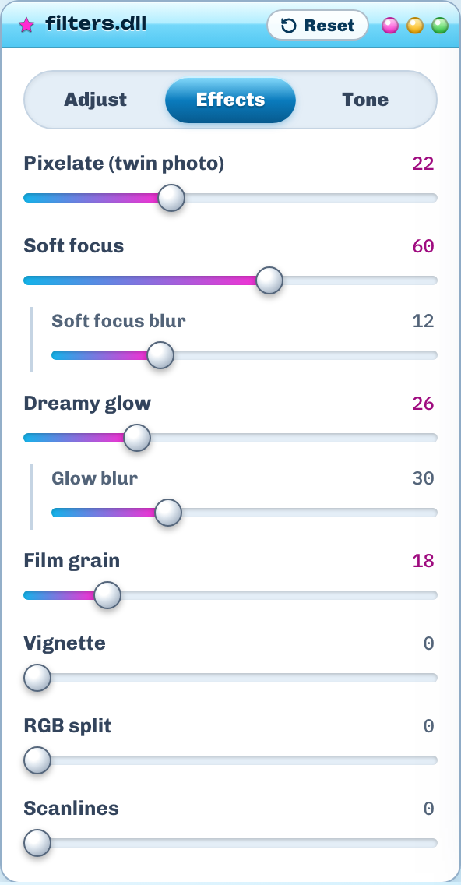
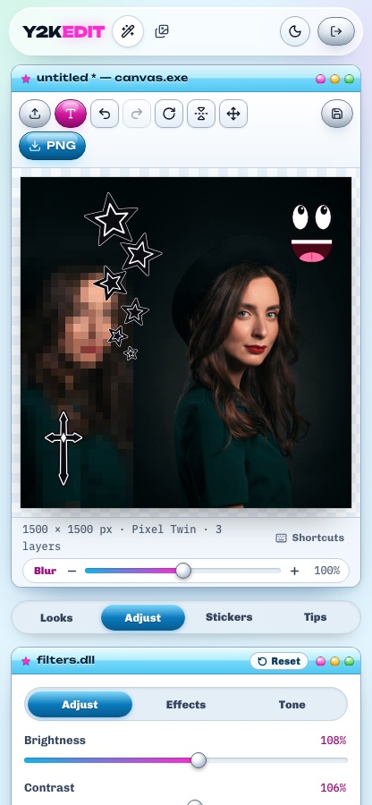

# Y2KEDIT ★

Make your photos hopelessly Y2K. Upload a photo, give it a whole look in one click (Frutiger Aero, Cybercore, Icon Twin, Lomo, Sacred Mono and more), tweak it with sliders, drop on stickers and chrome text, then download a PNG or save it to your gallery and share a link.

No AI: every look is plain canvas maths running in your browser, and your photo only leaves the device when you save.







## Features

- **29 presets** that each set filters, a layout and their own stickers or text. Sixteen are modelled on icon-edit pins: Old iPhone, Midnight, Night Flash, Night Blur, Washed Out, Noir Twin, Ember, Camcorder, Golden Grain, Under Arrest, Swag, Whatever, Star Girl, Scrapbook, Hotter than Hell, Soft Advisory. The originals are still there: Original, Icon Twin, Downtown, Sacred Mono, Pixel Pop, Advisory, Grunge B&W, Is this Illegal?, Frutiger Aero, Cybercore, Glitter Bling, Lomo / Disposable, Chrome. Every preset tile is rendered from *your* photo.
- **Layouts:** Single, Twin, Mirror and Pixel Twin. Two-photo layouts start in a 1:1 frame (or pick Fit, 4:5 or 3:4). **Arrange** mode lets you drag each photo inside its panel, zoom it with the wheel or a pinch, and drag the divider anywhere from 25% to 75%; you can also swap sides and join the panels with a cut, a thin line or a soft fade. Rotate and flip the source photo.
- **19 adjustments:** brightness, contrast, saturation, hue, warmth, tint, fade, sepia, grayscale, blur, pixelate, soft focus, dreamy glow, film grain, vignette, RGB split, scanlines, plus six split tones (Retro, Ember, Cinema, Midnight, Rose, Olive) and six duotones. Whenever a look has blur in it, a **Blur** meter appears under the canvas: turn it down to sharpen the look (0% keeps the colours but drops the softness) or up to 200% for more haze, with − and + for small steps. For finer control, Soft focus and Dreamy glow each have their own blur slider in the Effects tab.
- **55 built-in stickers** in six groups (faces and props like a moustache, nerd glasses and dog ears; stars; exclamations and marks; gothic crosses and advisory labels; flowers and butterflies; Y2K tech), and your own uploads: the server cuts out white backgrounds (flood-filled from the edges, so white details inside the sticker survive). Admin accounts' stickers are shared with everyone.
- **Text layers** in 15 styles (chrome, holo, neon, bubble, horror, datestamp, white, black, meme caption, glitter, VHS, echo, tooltip, chat bubble, speech bubble) and 9 fonts.
- **Undo / redo** and keyboard shortcuts (`⌘Z`, `⇧⌘Z`, `⌘S`, `⌘D`, `⌫`, arrows, `[ ]`, `T`, `A`, `?`).
- **Touch gestures:** drag, pinch to resize and twist to rotate on phones; trackpad pinch on desktop.
- **Lossless re-edit:** saved edits keep the original photo and every layer, not just the flattened PNG.
- **Gallery:** re-edit, rename, download, share (public link plus Pinterest, X and Tumblr), delete.
- **Accounts:** sign up, login with lockout after 5 failed tries, password reset by email. Resetting a password signs out every other session.
- Light and dark themes (follow the system, toggle to override) and a responsive layout down to phone width.

<p>
  
  &nbsp;&nbsp;
  
</p>

## Stack

| Part | What |
| --- | --- |
| Backend | FastAPI, PyMongo's native async client, MongoDB with GridFS for every image (no separate file storage), bcrypt, JWT in an httpOnly cookie, Pillow |
| Frontend | React 19, Vite, TypeScript, React Router, Lucide icons, Sonner toasts; hand-written CSS design system ([DESIGN.md](DESIGN.md)) |
| Rendering | One canvas renderer (`frontend/src/editor/render.ts`) draws the stage preview, preset thumbnails, the landing demo and the exported PNG, so what you see is what you download |

## Run it locally

You need Node 20+, Python 3.12+ (tested on 3.14) and MongoDB.

```bash
# 1. MongoDB (macOS / Homebrew)
brew tap mongodb/brew
brew install mongodb-community        # Homebrew 7 may ask you to `brew trust` the formula first
brew services start mongodb-community

# 2. Install everything (Python venv in backend/.venv, npm packages in frontend/)
npm install
npm run setup                          # PYTHON=python3.13 npm run setup to pick a specific Python

# 3. Start the API (:8000) and the web app (:5173) together
npm run dev
```

Open http://localhost:5173. Vite proxies `/api` to FastAPI, so everything runs on one origin and the session cookie just works.

Configuration lives in `backend/.env` (copy [`backend/.env.example`](backend/.env.example)). Everything has a local default. The ones you'll want:

- `JWT_SECRET`: set it, or everyone is signed out whenever the API restarts.
- `ADMIN_EMAILS`: comma-separated; stickers these accounts upload are shared with everyone.
- `RESEND_API_KEY`: sends real password-reset emails through [Resend](https://resend.com). Without it, the reset link is printed in the API terminal.

## Production

```bash
npm run start      # builds the frontend, then FastAPI serves it and the API on :8000
```

In this mode FastAPI also writes Open Graph and Twitter card tags into `/share/<slug>` pages, so shared links show the image on Pinterest, X and Tumblr. That only happens when FastAPI serves the built frontend; the Vite dev server can't do it. Behind HTTPS set `COOKIE_SECURE=true`, set `PUBLIC_URL` to the public origin (it's used in reset emails), and set `TRUST_PROXY=true` only if a proxy you control sets `X-Forwarded-For`.

## Tests

```bash
npm test           # 16 API tests against a throwaway `y2kedit_test` database
npm run typecheck  # TypeScript
```

The API tests cover auth (register, lockout, the reset flow revoking old sessions), edits (lifecycle, GridFS cleanup, ownership, share links, bad uploads) and stickers (background cut-out, visibility and permissions).

## API

| Method | Path | |
| --- | --- | --- |
| POST | `/api/auth/register` · `/login` · `/logout` | session cookie |
| GET | `/api/auth/session` · `/me` | current user (`session` returns `null` when signed out) |
| POST | `/api/auth/forgot-password` · `/reset-password` | always answers the same way, so it can't be used to discover which emails have accounts |
| GET / POST | `/api/edits` | list / create (multipart: `image` PNG, `source` photo, `state` JSON) |
| GET / PUT / PATCH / DELETE | `/api/edits/{id}` | detail with state / replace render / rename / delete (removes its GridFS files) |
| GET | `/api/edits/{id}/image` · `/thumb` · `/source` | owner only, ETag-cached |
| POST | `/api/edits/{id}/share` | `{ "is_public": bool }`; the slug survives going private |
| GET | `/api/public/edits/{slug}` · `/image` | no auth |
| GET / POST / PATCH / DELETE | `/api/stickers[/{id}]` | custom stickers; PATCH (publish) is admin-only |

## Project layout

```
backend/app/        FastAPI app: config, db (Mongo + GridFS), security, images (Pillow), routers/
backend/tests/      pytest suite
frontend/src/editor renderer, presets, stickers, text styles, undo history, editor panels
frontend/src/pages  landing, auth, editor, gallery, public share page
frontend/public     stickers (48 SVGs + 7 PNGs), sample photo
PRODUCT.md          who it's for and what it must keep doing
DESIGN.md           the visual system (tokens, components, rules)
```

## What changed from the original

This is a ground-up rewrite of the Emergent-generated version. The original couldn't run outside Emergent because it depended on Emergent's own object storage. Along the way it fixes these:

- Re-edit restored the flattened PNG, so filters were applied twice and layers were gone. Now the source photo and editor state are saved and restored.
- Preset stickers pointed at files that no longer existed, and the sticker-upload dialog never rendered.
- Preview and export used different code (CSS filters on screen, a different grain and vignette in the PNG). Now one renderer does both, with deterministic grain.
- The auth token was sent in image URLs (`?auth=`) and kept in localStorage. Now an httpOnly cookie is used on one origin.
- Deleting an edit left its image orphaned in storage. Now everything lives in GridFS and is deleted with it.
- The login lockout trusted a spoofable `X-Forwarded-For`. Now it does so only behind a trusted proxy.
- The server seeded an admin user with a default password. Now admins are just the emails you list in `ADMIN_EMAILS`.

## Credits

- Sample portrait: Unsplash photo [`photo-1581841064838-a470c740e8ee`](https://images.unsplash.com/photo-1581841064838-a470c740e8ee), Unsplash License.
- Fonts from Google Fonts: Unbounded, Chivo, IBM Plex Mono, Press Start 2P, UnifrakturCook, Tinos, Anton, VT323.
- Icons: [Lucide](https://lucide.dev).
- The chrome rockstar, halftone star, dot stars, parental advisory and pixel cursor stickers come from the original Y2KEDIT build; the other 50 stickers were drawn for this version.
